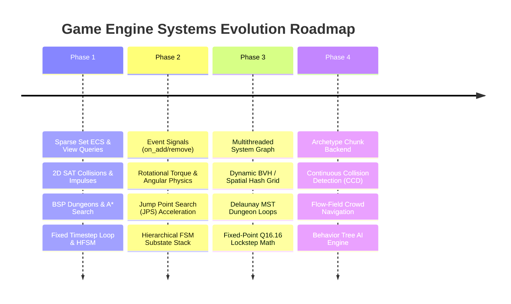

# Game Dev Labs: Core Game Engine Architecture & Systems Portfolio

[](https://github.com/ErenYeager1836/game-dev-labs/actions)
[](LICENSE)
[](CMakeLists.txt)

A production-grade, modular monorepo containing four fundamental **Game Engine Architecture and Simulation Systems** written in modern **C++17** for game programming, physics simulation, and systems engineering portfolio demonstration.

Each project explores a foundational technical pillar of modern game engines (such as Unreal Engine, Unity, Frostbite, and custom in-house proprietary engines):

---

## Master Projects Directory

| # | Subproject | Focus Domain | Key Algorithms & Mechanics | Automated Tests | Folder | Design Note |
| :---: | :--- | :--- | :--- | :---: | :---: | :---: |
| **1** | **`ecs`** | Data-Oriented Design & Memory Locality | Cache-friendly Sparse Set architecture, $O(1)$ addition/removal/lookup, swap-and-pop packed array defragmentation, entity ID recycling, and multi-component view filter queries | **6 Tests** | [`ecs/`](ecs/) | [DESIGN.md](ecs/DESIGN.md) |
| **2** | **`physics-2d`** | Rigid Body Dynamics & Collision | Separating Axis Theorem (SAT) for convex polygons and circles, Minimum Translation Vector (MTV) penetration extraction, impulse-based momentum solver, Coulomb surface friction, and anti-sink positional slop projection | **7 Tests** | [`physics-2d/`](physics-2d/) | [DESIGN.md](physics-2d/DESIGN.md) |
| **3** | **`pathfinding-procgen`** | Procedural Generation & Navigation | Binary Space Partitioning (BSP) dungeon generation with $100\%$ room connectivity guarantee, Cellular Automata 4-5 cave smoothing, and $A^*$ search with Manhattan/Octile heuristics and priority queue tie-breaking | **7 Tests** | [`pathfinding-procgen/`](pathfinding-procgen/) | [DESIGN.md](pathfinding-procgen/DESIGN.md) |
| **4** | **`game-loop-fsm`** | Deterministic Timing & State Systems | Glenn Fiedler's "Fix Your Timestep!" accumulator pattern, render interpolation alpha factor ($\alpha$), spiral-of-death clamp, type-safe Pub/Sub Event Bus, and Hierarchical Character Controller State Machine | **7 Tests** | [`game-loop-fsm/`](game-loop-fsm/) | [DESIGN.md](game-loop-fsm/DESIGN.md) |

---

## Monorepo Layout

```text
game-dev-labs/
├── .github/
│   └── workflows/
│       └── ci.yml                  # GitHub Actions CI matrix (Ubuntu GCC & Windows MSVC)
├── ecs/                            # Project 1: Sparse Set Entity Component System
│   ├── CMakeLists.txt
│   ├── include/ecs/
│   │   ├── component_pool.hpp      # Contiguous dense memory + sparse indexing
│   │   ├── components.hpp          # Standard POD components (Position, Velocity, Health)
│   │   ├── entity.hpp              # 32-bit EntityID definitions
│   │   ├── registry.hpp            # Entity manager and multi-component view queries
│   │   └── systems.hpp             # Movement & Combat systems
│   ├── src/main_ecs.cpp            # High-scale 50,000 entity benchmark CLI
│   ├── tests/test_ecs.cpp          # 6 automated unit & memory stress tests
│   ├── DESIGN.md                   # Data-Oriented Design vs OOP analysis
│   └── README.md
├── physics-2d/                     # Project 2: 2D Physics & SAT Collision Engine
│   ├── CMakeLists.txt
│   ├── include/physics2d/
│   │   ├── aabb.hpp                # Axis-Aligned Bounding Box broadphase
│   │   ├── body.hpp                # RigidBody dynamics & kinematic properties
│   │   ├── collision.hpp           # SAT narrowphase collision algorithms
│   │   ├── manifold.hpp            # Contact point, normal, and penetration depth
│   │   ├── shapes.hpp              # Circle and convex Polygon primitives
│   │   ├── vec2.hpp                # 2D vector math (dot, cross, reflection, rotation)
│   │   └── world.hpp               # PhysicsWorld orchestrator & impulse solver
│   ├── src/main_physics.cpp        # CLI bouncing ball & telemetry simulation
│   ├── tests/test_physics.cpp      # 7 automated unit & momentum conservation tests
│   ├── DESIGN.md                   # Mathematical derivations (SAT, Impulse, Slop)
│   └── README.md
├── pathfinding-procgen/            # Project 3: PCG & A* Navigation Engine
│   ├── CMakeLists.txt
│   ├── include/pathfinding/
│   │   ├── astar.hpp               # A* search algorithm with priority queue
│   │   ├── grid_map.hpp            # 2D GridMap tile storage & bounds checking
│   │   └── procgen.hpp             # BSP dungeon & Cellular Automata cave generators
│   ├── src/main_pathfinding.cpp    # Interactive colorful ANSI map & path demo
│   ├── tests/test_pathfinding.cpp  # 7 automated unit & connectivity test cases
│   ├── DESIGN.md                   # Heuristic admissibility & BSP tree notes
│   └── README.md
├── game-loop-fsm/                  # Project 4: Fixed-Timestep Loop & HFSM
│   ├── CMakeLists.txt
│   ├── include/gameloop/
│   │   ├── event_bus.hpp           # Type-safe EventBus (subscribe/publish)
│   │   ├── state_machine.hpp       # State, StateMachine, and Character Controller
│   │   └── timestep.hpp            # TimestepManager accumulator & lerp helper
│   ├── src/main_loop.cpp           # Real-time CLI loop, input, and transition demo
│   ├── tests/test_game_loop.cpp    # 7 automated unit & timing validation test cases
│   ├── DESIGN.md                   # Loop mathematics & FSM state diagrams
│   └── README.md
├── CMakeLists.txt                  # Monorepo master build orchestrator
├── LICENSE                         # MIT License
└── .gitignore                      # C++ build artifacts and cache ignore rules
```

---

## Quickstart: Building & Running Tests

### 1. Prerequisites
- **Compiler**: Modern C++17 compiler (GCC 9+, Clang 10+, or MSVC 2019+).
- **Build System**: CMake 3.16+.

### 2. Build All Subprojects

#### On Windows (PowerShell / MSVC):
```powershell
cmake -B build -S .
cmake --build build --config Release
```

#### On Linux / macOS:
```bash
cmake -B build -S . -DCMAKE_BUILD_TYPE=Release
cmake --build build
```

### 3. Run the Automated Test Suite (CTest)
The monorepo contains **27 automated tests** across all 4 engine modules:
```bash
ctest --test-dir build -C Release --output-on-failure
```
*Sample Output:*
```text
Test project .../game-dev-labs/build
    Start 1: ECSTest
1/4 Test #1: ECSTest ..........................   Passed    0.02 sec
    Start 2: PhysicsTest
2/4 Test #2: PhysicsTest ......................   Passed    0.02 sec
    Start 3: PathfindingTest
3/4 Test #3: PathfindingTest ..................   Passed    0.03 sec
    Start 4: GameLoopTest
4/4 Test #4: GameLoopTest .....................   Passed    0.02 sec

100% tests passed, 0 tests failed out of 4
```

---

## Tool-by-Tool Demos & Usage

### 1. `ecs` Benchmark CLI Demo
Spawns 50,000 entities and executes 100 simulation ticks, measuring memory allocation latency and component update throughput:
```bash
./build/ecs/Release/ecs_demo.exe 50000
```
*Throughput: **>25 to 55 Million component updates/sec** with sub-millisecond frame updates.*

### 2. `physics-2d` Real-Time Simulation Demo
Simulates a bouncing rigid body dropping under gravity onto a static surface:
```bash
./build/physics-2d/Release/physics_demo.exe
```
*Visualizes real-time trajectory, altitude, restitution rebounds, and kinetic energy over time.*

### 3. `pathfinding-procgen` Dungeon & Cave Demo
Generates a 48x18 procedural BSP dungeon, picks two distant room centers, and navigates between them using $A^*$:
```bash
./build/pathfinding-procgen/Release/pathfinding_demo.exe
```
*Renders colorful ANSI terminal maps displaying rooms (`.`), walls (`#`), hero start (`S`), goal (`G`), and optimal path steps (`*`).*

### 4. `game-loop-fsm` Fixed-Tick & State Machine Demo
Runs a variable-frame-rate game loop feeding player inputs into the character controller state machine:
```bash
./build/game-loop-fsm/Release/gameloop_demo.exe
```
*Demonstrates state progression (`Idle` $\to$ `Walk` $\to$ `Jump` $\to$ `Fall` $\to$ `Attack`) and decoupled EventBus delivery.*

---

## Architectural Insights & Interview Talking Points

1. **Why Data-Oriented Design (DoD) Beats OOP in Game Engines**:
   - In traditional Object-Oriented game development, game objects contain virtual methods (`virtual void update()`) and are scattered across the heap. Iterating through them incurs severe CPU pointer chasing and continuous L1/L2 cache evictions.
   - The Sparse Set ECS stores components in contiguous arrays (`dense_`). The CPU hardware prefetcher streams consecutive component structs directly into cache lines, maximizing vectorized throughput.

2. **The Separating Axis Theorem (SAT) Mechanics**:
   - For convex polygons and circles, if an axis exists where their 1D orthogonal projections do not overlap, they cannot be colliding.
   - SAT not only detects collisions, but also extracts the **Minimum Translation Vector (MTV)**—the axis with the smallest overlap—which directly serves as the contact normal for impulse resolution.

3. **Why Fixed Timestep is Non-Negotiable for Physics & Multiplayer**:
   - Numerical integration (`Euler`/`Verlet`) diverges if $\Delta t$ fluctuates. Large frame drops cause objects to tunnel through solid walls.
   - Decoupling physics (e.g. fixed 60Hz tick) from rendering (variable 144Hz+) using an accumulator and interpolation alpha ($\alpha = \text{remainder} / \text{fixed\_dt}$) guarantees 100% deterministic simulation while keeping visuals buttery smooth.

4. **Admissible Heuristics in $A^*$ Pathfinding**:
   - $A^*$ is guaranteed to find the optimal shortest path if its heuristic $h(n)$ is admissible ($h(n) \le h^*(n)$).
   - On 4-way cardinal grids, Manhattan distance ($|dx| + |dy|$) is used; on 8-way diagonal grids, Octile distance ($max(dx, dy) + (\sqrt{2}-1)min(dx, dy)$) is used to avoid overestimating diagonal costs.

---

## Game Engine Systems Roadmap



### Detailed Subproject Roadmap

#### 1. `ecs`
- [x] Sparse Set contiguous storage with swap-and-pop removal.
- [x] $O(1)$ amortized component addition, lookup, and deletion.
- [x] Multi-component view filter queries.
- [x] Entity ID recycling and lifecycle tracking.
- [x] **Component Event Signals**: Reactive callbacks (`on_construct`, `on_destroy`) for event-driven system triggers.
- [ ] **Multi-Threaded System Dispatcher**: Task graph scheduler allowing independent systems (e.g., Movement and Audio) to run concurrently across worker threads.
- [ ] **Component Reflection & Serialization**: Automated binary state saving and network synchronization.
- [ ] **Archetype Chunk Backend**: Alternate chunk-based storage option for homogenous mass entity counts (>500k entities).

#### 2. `physics-2d`
- [x] Vector2 mathematics with dot, cross, reflection, and rotation.
- [x] Separating Axis Theorem (SAT) for convex polygons and circles.
- [x] Impulse velocity solver with restitution and Coulomb friction.
- [x] Anti-penetration slop projection.
- [x] **Rotational Dynamics & Moment of Inertia**: Coupling torque, angular velocity, and moment of inertia to contact points ($J_t \times r$, $r \times F$, angular integration).
- [ ] **Spatial Hash / Dynamic BVH Tree**: Replacing $O(N^2)$ pairwise checks with a dynamic AABB bounding volume hierarchy.
- [ ] **Continuous Collision Detection (CCD)**: Raycast / swept circle continuous time-of-impact (TOI) solver to eliminate tunneling.
- [ ] **Constraint Solvers**: Distance joints, revolute pin joints, and spring dampers.

#### 3. `pathfinding-procgen`
- [x] Discrete 2D GridMap with bounds and walkability checks.
- [x] A* search algorithm with Manhattan and Octile heuristics.
- [x] BSP procedural dungeon generator with guaranteed connectivity.
- [x] Cellular Automata organic cave smoothing.
- [x] **Flow Field Pathfinding**: Dijkstra integration cost fields and 2D vector gradient fields for instantaneous $O(1)$ mass-crowd multi-agent navigation.
- [ ] **Jump Point Search (JPS)**: Order-of-magnitude acceleration on uniform-cost grids by skipping intermediate symmetry nodes.
- [ ] **Hierarchical Pathfinding (HPA\*)**: Hierarchical abstraction clustering the grid into chunks for high-performance massive world routing.
- [ ] **Dungeon Loops with Delaunay Triangulation & MST**: Replacing sequential L-corridors with Delaunay graph triangulation and Kruskal's algorithm to generate loops and secret passageways.

#### 4. `game-loop-fsm`
- [x] Fixed-timestep accumulator loop with spiral-of-death clamp.
- [x] Render interpolation blending factor ($\alpha$).
- [x] Decoupled pub/sub `EventBus`.
- [x] Hierarchical character state machine with lifecycle callbacks.
- [x] **State Machine Stack (Push/Pop Substates)**: State stacking (e.g. pushing a `PauseMenuState` or `InventoryState` over the active gameplay state and resuming seamlessly).
- [x] **Behavior Tree Engine**: Hierarchical Selector/Sequence composite nodes with Blackboards and Inverter decorators for advanced NPC artificial intelligence.
- [ ] **Fixed-Point Determinism Module**: Fixed-point integer math (`fixed32`) for 100% cross-architecture lockstep networking.
- [ ] **Frame Budget Profiler**: Built-in microsecond instrumentation tracking CPU tick budget utilization and detecting physics frame drops.

---

## License

This project is licensed under the MIT License - see the [LICENSE](LICENSE) file for details.
